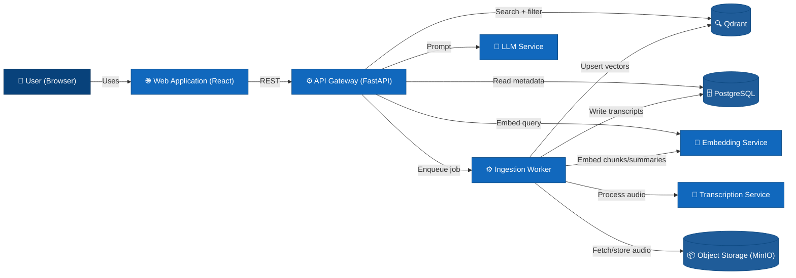

# Level 2: Containers

## Container list

| Container | Technology | Responsibility |
|-----------|------------|----------------|
| Web Application | React, TypeScript | User interface for search and meeting upload |
| API Gateway | Python, FastAPI | Orchestrates all requests, hybrid search, RAG context building |
| Ingestion Worker | Python | Diarization, transcription, chunking, embedding |
| PostgreSQL | PostgreSQL 15 | Structured data: raw transcripts, metadata, speaker records |
| Qdrant | Qdrant | Vector store: chunk embeddings, summary vectors, voice signatures |
| Object Storage | S3 / MinIO | Audio file binaries |
| Transcription Service | Pyannote + Whisper (wrapped as a service) | Diarization and speech-to-text |
| Embedding Service | Custom model (e.g., sentence-transformers) | Text and voice embedding generation |
| LLM Service | Local LLM (e.g., llama.cpp) | Final answer generation with RAG context |

## Diagram

Redis is implied for task queuing between API and Worker but not shown as a main container for simplicity.