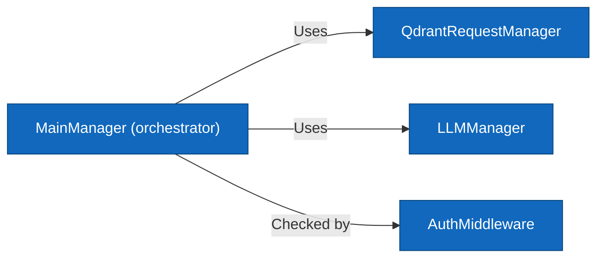
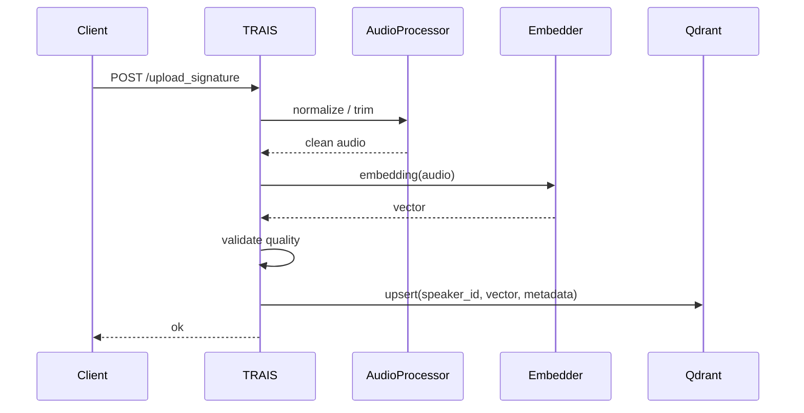
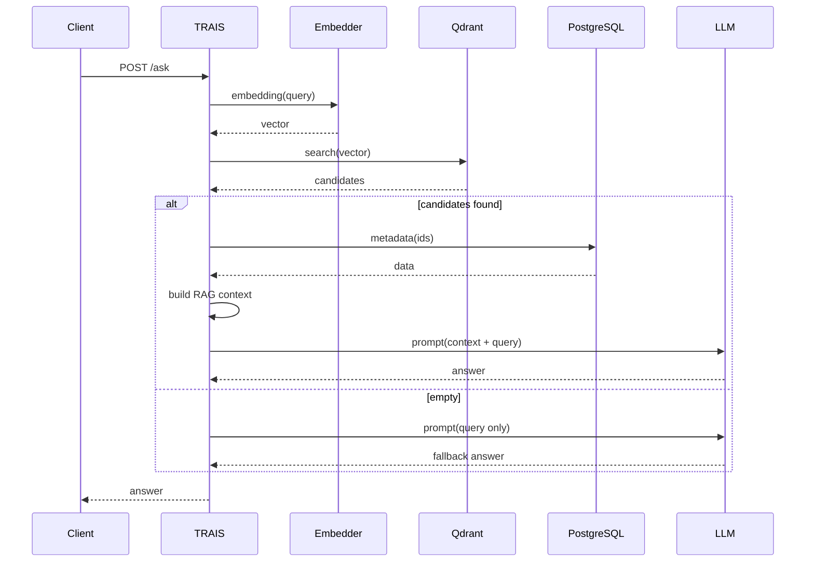
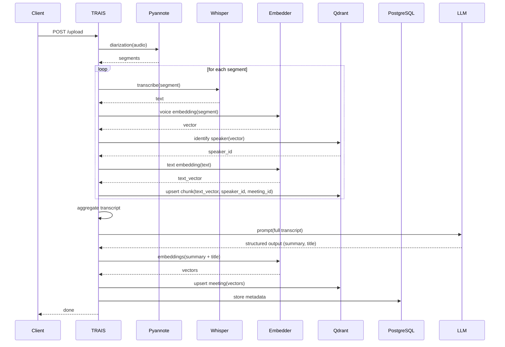

# Level 3: Components

## API Gateway – internal components

The API Gateway is built around a central `MainManager` that orchestrates all operations.  
Specialised managers handle communication with external services, while `AuthMiddleware` enforces security.

| Component | Responsibility |
|-----------|----------------|
| `MainManager` | Accepts `/ask` and `/upload` requests, builds RAG context, coordinates search and ingestion |
| `QdrantRequestManager` | Encapsulates gRPC calls to Qdrant |
| `LLMManager` | Communicates with the LLM service |
| `AuthMiddleware` | (future) Authentication and rate limiting |

## Sequence diagrams for core flows

These diagrams illustrate how the components collaborate.

### Upload Voice Signature

### Ask LLM

### Upload Meeting
