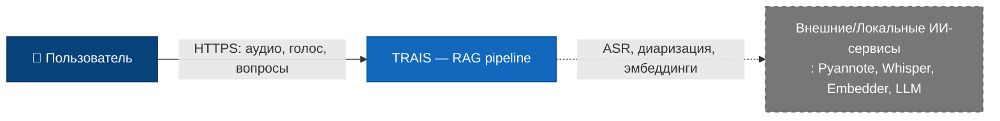

# Уровень 1: Контекст системы

TRAIS как целостная система взаимодействует с одним типом пользователей и, опционально, с внешней инфраструктурой.

**Действующие лица:**
- **Пользователь** – человек, который загружает аудио встреч, отправляет голосовые подписи и задаёт вопросы на естественном языке.
- **ИИ-сервисы** – Pyannote, Whisper, Embedder, LLM. При полностью локальном развёртывании они являются внутренними контейнерами, но могут рассматриваться как внешние, если предоставляются отдельной платформой.

В полностью локальной установке все ИИ-компоненты работают внутри границ системы, поэтому внешним является только пользователь
