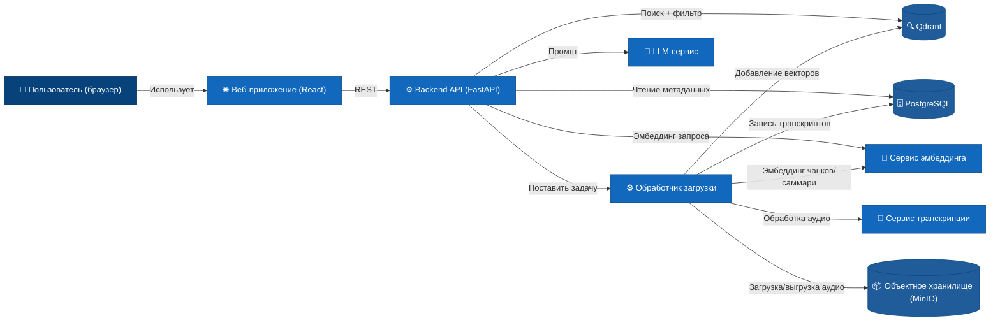

# Уровень 2: Контейнеры

## Список контейнеров

| Контейнер | Технология | Ответственность |
|-----------|------------|-----------------|
| Веб-приложение | React, TypeScript | Пользовательский интерфейс для поиска и загрузки встреч |
| Backend API | Python, FastAPI | Оркестрация всех запросов, гибридный поиск, построение RAG‑контекста |
| Обработчик загрузки | Python | Диаризация, транскрипция, разбивка на чанки, эмбеддинг |
| PostgreSQL | PostgreSQL 15 | Структурированные данные: сырые транскрипты, метаданные, записи о спикерах |
| Qdrant | Qdrant | Векторное хранилище: эмбеддинги чанков, векторы саммари, голосовые подписи |
| Объектное хранилище | S3 / MinIO | Бинарные файлы аудио |
| Сервис транскрипции | Pyannote + Whisper (обёрнутые как сервис) | Диаризация и распознавание речи |
| Сервис эмбеддинга | Собственная модель (например, sentence-transformers) | Генерация текстовых и голосовых эмбеддингов |
| LLM‑сервис | Локальная LLM (например, llama.cpp) | Генерация финального ответа на основе RAG‑контекста |

## Диаграмма

Redis подразумевается для очереди задач между API и Обработчиком, но для простоты не показан как отдельный контейнер.
